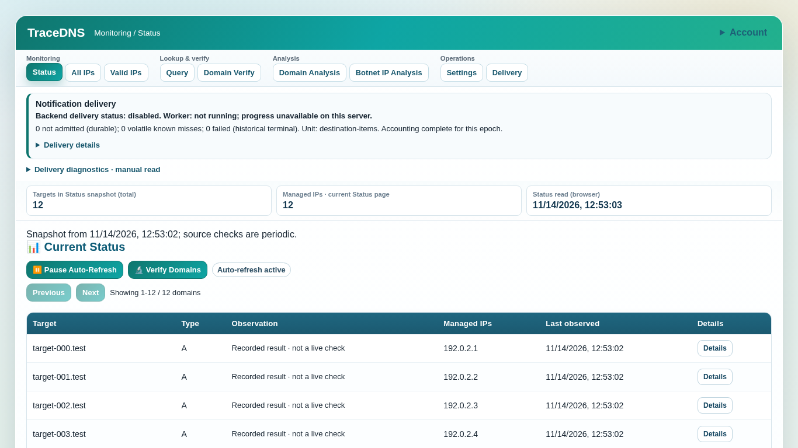
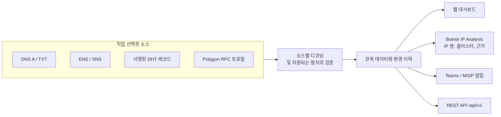

<div align="center">

# TraceDNS

**최신 IP 하나를 넘어, 지표 뒤에서 바뀌는 인프라를 추적하세요.**

[](#quick-start)
[](LICENSE)
[](docs/security/deployment.md)
[](docs/API.md)

[English](README.md) · [한국어](README.ko.md)

[**빠른 시작**](#quick-start) · [**조사 흐름**](#an-investigation-from-start-to-finish) · [**지원하는 소스**](#decoders-and-advanced-target-types) · [**REST API**](docs/API.md) · [**문서**](#documentation)

</div>

---

> TXT 레코드에 주소가 숨겨져 있을 수 있습니다.
> 네이밍 레코드가 가리키는 엔드포인트가 바뀔 수도 있습니다.
> 여러 IP가 같은 인프라를 사용한다고 해서 같은 캠페인에 속하는 것은 아닙니다.

**TraceDNS**는 DNS, 블록체인 네이밍 레코드, 서명된 DHT 레코드로 공개되는 인프라를
추적하는 분석가를 위한 자체 호스팅 모니터링·조사 도구입니다. 레코드 수집, 주소
디코딩, 변경 이력, IP 관계 분석, 선택적 알림을 **하나의 웹 대시보드**에서 다룹니다.
바탕이 된 관측 데이터를 보관하므로, 분석가는 결과를 이용 가능한 근거와
대조하며 검토할 수 있습니다.

<p align="center">
  
</p>

*격리된 로컬 인스턴스에 예약된 예제 주소를 넣고 외부 연동을 비활성화한 실제
Status 화면입니다. 1366×768 전체 viewport를 잘라내지 않고 캡처했습니다.
운영 데이터나 실시간 위협 인텔리전스 결과를 보여주는 화면이 아닙니다.*

<a id="how-it-works"></a>
## 동작 방식



<a id="highlights"></a>
## 주요 기능

| | 기능 | 제공하는 내용 |
| --- | --- | --- |
| 📡 | **고정된 목록 대신 소스 추적** | 소스와 디코딩 설정을 한 번 저장하면 주기적인 관측과 이력으로 변화를 확인할 수 있습니다. 설정 수정이 DNS 변경으로 표시되지는 않습니다. |
| 🧩 | **다양한 탐색 방식을 한 화면에서 확인** | DNS A/TXT, ENS, SNS, 서명된 DHT 레코드, 지원되는 Polygon RPC 프로필을 같은 대시보드에서 다루며, 소스별 세부 정보도 그대로 보존합니다. |
| 🔓 | **디코딩한 뒤 근거 확인** | 일반 주소와 인코딩된 주소를 위한 내장 디코더, 제한된 연산으로 구성하는 사용자 정의 디코더를 제공합니다. 저장 전에 **Preview**로 확인할 수 있습니다. 서명된 DHT 레코드와 인증을 지원하는 RPC·ENS 형식에는 서명 또는 인증 검증이 적용됩니다. |
| 🕸️ | **IP와 관계 단서를 함께 검토** | **Botnet IP Analysis**에서 IP 쌍, 클러스터, 관계의 근거를 살펴봅니다. Graph·Map 보기, 필터, JSON 내보내기를 지원하며, 고유 IP를 최대 10,000개까지 입력할 수 있습니다. |
| 🔔 | **실제 전송 상태를 구분하는 알림** | Teams / MISP 알림은 선택 사항입니다. 전송 진단은 *대기 중*과 *전송 완료*를 구분합니다. 24시간의 제거 유예와 재등장 알림 억제로 불필요한 알림을 줄입니다. |
| 👥 | **팀 공동 사용** | 로컬 계정, `admin` / `operator` / `viewer` 역할, 사용자별 감사 기록을 제공합니다. 인증된 REST API와 OpenAPI 명세, 표준 라이브러리만 사용하는 Python 클라이언트도 제공합니다. |

Teams, MISP, VirusTotal 연동은 선택 사항입니다. 초기 설정에는 모니터링 대상이
없고 외부 연동도 활성화되어 있지 않습니다. 무엇을 모니터링하고 어떤 외부
서비스를 사용할지는 직접 선택합니다.

<a id="quick-start"></a>
## 빠른 시작

자신의 컴퓨터에서 로컬 대시보드를 실행합니다. **필요한 것:** Python 3.11 이상,
브라우저, 선택한 대상이 사용하는 DNS 리졸버 또는 주소 탐색 서비스에 대한 접근.

<details>
<summary>요구 사항, 선택적 기능, Python 3.10 사용자를 위한 안내</summary>

- Python 3.11 이상. Linux 검증 매트릭스는 Python 3.11과 3.12를 대상으로 합니다.
- 대시보드에 접속할 브라우저.
- 선택한 대상이 사용하는 DNS 리졸버 또는 주소 탐색 서비스에 대한 접근.

아래 절차는 Python 3.12와 새 가상 환경을 사용합니다. Python 3.11로 대신할 수도
있습니다. Node.js는 브라우저 테스트에 필요하며, 대시보드 서비스에는 필요하지 않습니다.

| 선택적 기능 | 추가 설정 |
| --- | --- |
| ENS | 같은 환경에 `requirements-ens.txt`를 설치하고 ENS RPC URL을 설정합니다. `--no-deps`가 아니라 일반적인 의존성 해결 방식으로 설치하세요. |
| VirusTotal | Settings에서 VT API 키를 설정합니다. 별도의 VT SDK는 필요하지 않습니다. |
| Teams / MISP | Settings에서 전송 대상을 설정합니다. PyMISP는 기본 의존성에 포함되어 있습니다. |
| GeoIP 국가 정보 보완 | `GEOIP_MMDB_PATH` 또는 설정의 `geoip_mmdb_path`로 MaxMind `.mmdb` 파일을 지정합니다. 기본 의존성에 `geoip2`가 포함되어 있습니다. |

이미 Python 3.10에서 TraceDNS를 실행 중이라면, 전환 전에 별도의 Python 3.11+
환경을 준비하고 검증하세요. 기존 환경과 일관된 상태 백업을 보관하세요.
이 안내는 신규 설치를 위한 것이며 실행 중인 서비스의 기존 환경을 직접
업그레이드하는 절차가 아닙니다.

</details>

### 1. 새로 체크아웃한 저장소에 설치

`tracedns` 체크아웃 디렉터리를 포함하는 상위 디렉터리에서 실행하세요.

```bash
cd tracedns
python3.12 -m venv .venv
. .venv/bin/activate
python -m pip install -r requirements-bootstrap.txt
python -m pip install -r requirements.txt
```

### 2. 로컬 설정과 관리자 생성

예제에는 모니터링 대상이나 외부 연동이 없고, 루프백 DNS 서버만 설정되어 있습니다.
이 절차에서는 기존 배포의 설정이나 계정 데이터베이스를 재사용하지 마세요.

```bash
cp -n dns_config.json_example dns_config.json
# Password is prompted, never passed in an argument.
python -m security.cli --db ./local-security/auth.sqlite bootstrap admin
```

`cp -n`은 기존 설정 파일을 덮어쓰지 않습니다. 파일이 이미 있다면 초기 설정이
복사되었다고 가정하지 말고, 여기서 멈춘 뒤 별도로 체크아웃한 디렉터리를 사용하세요.

### 3. 로컬 대시보드 시작

```bash
python dns_monitor.py \
  --config dns_config.json \
  --security-db ./local-security/auth.sqlite \
  --http-host 127.0.0.1 --http-port 8000 --insecure-http
```

같은 컴퓨터에서 `http://127.0.0.1:8000`을 열고 `admin`으로 로그인하세요.
대상을 추가하기 전까지 대시보드가 비어 있는 것은 정상입니다. 터미널은 실행 상태로
두고, 로컬 인스턴스를 종료하려면 Ctrl+C를 누르세요.

### 4. 첫 대상 추가

1. **Settings**의 **Advanced server configuration**을 열고 예제의 루프백 리졸버를
   사용할 DNS 리졸버로 바꾼 뒤 저장합니다. 로컬 리졸버를 운영 중인 경우에만
   그대로 두세요.
2. **Domain Verify**를 열고 직접 선택한 대상을 입력한 뒤 유형과 디코더를 고릅니다.
   반환된 값을 검토한 후 모니터링에 추가합니다.
3. **Status**에서 저장된 대상을, **All IPs**에서 추출된 주소를 확인합니다.
4. 외부 정보 보강이나 알림은 해당 연동을 설정한 후에만 활성화합니다.

이 절차는 루프백에서만 평문 HTTP를 사용합니다. 다른 컴퓨터에서 대시보드에
접근하려면 아래 설명대로 HTTPS를 설정하세요. 예제의 리스너를 그대로 네트워크에
노출해서는 안 됩니다.

**다음 단계:** [조사의 시작부터 마무리까지](#an-investigation-from-start-to-finish)를 따라가거나,
[다중 사용자 접근과 HTTPS](#multi-user-access-and-deployment)를 설정하세요.

<a id="an-investigation-from-start-to-finish"></a>
## 조사의 시작부터 마무리까지

1. **소스를 선택합니다.** 조사 과정에서 의도적으로 선택한 대상을 사용하세요.
   DNS, 네이밍 레코드, DHT 공개 키 또는 지원되는 RPC 프로필을 선택합니다.
   TraceDNS가 연구용 대상을 자동으로 모니터링 목록에 넣지는 않습니다.
2. **모니터링 전에 검증합니다.** **Domain Verify**에서 반환된 레코드와 추출된
   주소를 확인합니다. 인코딩된 데이터라면 제공되는 디코딩 결과를 비교하거나
   사용자 정의 디코더를 저장 전에 미리 확인합니다.
3. **대상을 저장합니다.** 검증한 설정을 추가하고 **Settings**에서 조회 주기를
   정합니다. 관측 데이터가 들어오면 **Status**와 이력을 살펴봅니다.
4. **관계를 조사합니다.** 모니터링 중인 도메인의 통계는 **Domain Analysis**에서,
   IP 목록에 대한 조사는 **Botnet IP Analysis**에서 진행합니다. 결론을 내리기 전에
   관계의 근거와 분석 범위 경고를 확인합니다.
5. **공유하거나 자동화합니다.** 분석 JSON을 내보내거나, API로 관측 데이터를
   읽거나, Teams/MISP 알림을 활성화합니다. 전송 결과가 불확실한 알림을 다시
   보내기 전에는 전송 진단을 확인하세요.

예를 들어 선택한 TXT 레코드가 인코딩된 주소 하나를 공개하다 나중에 다른 주소로
바뀌었다고 가정해 봅시다. TraceDNS는 이 변화의 관측 기록을 보관하고, 추출된
IP를 다른 조사 자료와 비교할 수 있게 합니다. 같은 호스팅 제공업체를 쓴다는 것은
확인해 볼 단서이지, 두 IP의 운영자가 같다는 증거가 아닙니다. 이는 사용 흐름을
설명하기 위한 예시이며 실제 수집한 사건이나 벤치마크가 아닙니다.

콘솔은 결과와 분석 범위를 먼저 보여주고, 선택한 대상 하나의 근거와 고급 설정을
분리합니다. Status의 **Details**에서 원문과 History를 열고, Domain Analysis의
**Manage domains**에서 삭제를 명시적으로 활성화합니다. 미조회 수치는 0이 아니며
현재 페이지 수치는 전역 총계가 아닙니다. 범위, 편집 초안, 취소, 캐시 조회와 외부
작업의 차이는 [화면 사용 안내](docs/VIEW_PRESENTATION.md)를 참고하세요.

<a id="inside-botnet-ip-analysis"></a>
## Botnet IP Analysis 살펴보기

이 작업 화면은 역할이 아직 밝혀지지 않은 IP 사이의 관계를 조사하기 위한 것입니다.
이름에 Botnet이 들어간다고 해서 입력한 모든 IP가 봇, 감염 호스트 또는 C2 서버라는
뜻은 아닙니다.

| 작업 단계 | 확인하거나 조정할 수 있는 항목 |
| --- | --- |
| 입력 준비 | 줄바꿈, 쉼표 또는 공백으로 구분한 IP를 붙여 넣습니다. 중복 IP는 한 번만 분석하며, 유효하고 고유한 IP를 최대 10,000개까지 입력할 수 있습니다. |
| 맥락 추가 | 이용 가능한 VirusTotal 인프라 데이터, 선택적 GeoIP 국가 정보 보완, 로컬 DNS 출처 정보, 선택한 MISP 이벤트의 맥락을 사용합니다. 이용 가능 여부는 설정과 보관된 데이터에 따라 다릅니다. |
| 분석 프로필 선택 | Balanced로 시작하거나 Conservative, Aggressive 또는 저장한 Custom 설정을 선택합니다. 고급 설정에는 IP 쌍 선택과 이웃 수 제한이 포함됩니다. |
| 작업 상태 확인 | 진행 상황을 확인하고 취소를 요청합니다. 브라우저 polling이 멈췄다고 서버 작업의 중단이 확인된 것은 아닙니다. |
| 결과 검토 | IP 쌍과 클러스터 표를 확인하거나 Graph·Map으로 전환합니다. IP, 소유자, 국가 또는 근거로 결과를 필터링합니다. |
| 분석 범위 확인 | 결과와 함께 분석 범위·품질 지표를 확인합니다. 제한된 범위의 결과나 일부 정보만 보강된 결과는 전수 조사 결과가 아닙니다. |
| 사본 보관 | 검토나 후속 처리를 위해 분석 결과를 JSON으로 내보냅니다. |

관계 분석에는 공유 도메인, 인프라 속성, 이용 가능한 TLS 또는 위협 인텔리전스
맥락이 사용될 수 있습니다. 그래프는 분석 결과 중 제한된 범위를 보여주며, 모든
호스트나 가능한 모든 관계를 나타내는 지도는 아닙니다. 클러스터는 채택된 관계로
연결된 집합입니다. 모든 구성원이 다른 모든 구성원과 직접 관련 있다는 뜻은 아닙니다.

VirusTotal 정보 보강과 MISP 맥락은 선택적 외부 입력입니다. 해당 정보의 유무와
오래된 정도에 따라 내릴 수 있는 결론이 달라집니다. 관계 점수로 후속 조사
우선순위를 정하기 전에 바탕이 된 관측 데이터를 검토하세요.

**Inspect pair/cluster**는 캐시된 근거만 엽니다. **Analyze cluster**는 입력을 바꾸고
Per-IP 정보 보강을 실행하며, Map 국가를 활성화하면 해당 국가의 IP로 입력을 바꾸고
관계 분석을 다시 실행합니다. 재실행이 실패하면 이전 성공 결과와 내보내기를 오래된
결과로 보존하며, 해당 결과의 분석 범위 경고도 계속 표시합니다.

<a id="where-it-fits"></a>
## 활용 예시

| 하려는 작업 | TraceDNS에서의 작업 | 얻을 수 있는 결과 |
| --- | --- | --- |
| 악성코드 분석 중 발견한 인프라 추적 | 선택한 레코드 소스를 등록하고 디코더를 검증합니다. | 현재 추출된 주소와 관측된 변경 이력. |
| 의심스러운 IP 집합의 초기 분류 | Botnet IP Analysis에 IP 목록을 붙여 넣고 관계 근거를 검토합니다. | 추가 조사할 관계 후보. 자동 감염 판정은 아닙니다. |
| 서명되거나 온체인에 기록된 설정 소스 추적 | 지원되는 DHT, ENS, SNS 또는 RPC 대상 유형을 선택하고 소스별 결과를 확인합니다. | 공개된 주소와 이용 가능한 소스·인증 정보. |
| 새로운 관측 내용을 팀과 공유 | Teams나 MISP를 설정한 뒤 전송 상태를 모니터링합니다. | 전송 상태가 명시된 알림. |
| 스크립트나 외부 분석 보조 도구 연결 | 인증된 REST API와 독립 실행형 Python 클라이언트를 사용합니다. | UI와 동일한 역할·감사 규칙이 적용되는 프로그래밍 방식의 접근. |

<a id="scope-and-limits"></a>
## 범위와 한계

보안 도구에서는 신뢰가 중요합니다. TraceDNS가 **보장하지 않는 것**을 명확히 설명합니다.

TraceDNS는 관측과 조사를 위한 도구입니다. 엔드포인트 보호 에이전트가 아니며,
네트워크 텔레메트리를 대체하지 않습니다.

- **감염 여부를 입증하지 않습니다.** 디코딩된 IP, 공유 ASN, 인증서 또는
  클러스터만으로 악성 활동이나 동일한 소유 관계가 증명되지는 않습니다.
- **완전히 수동적인 도구는 아닙니다.** 실시간 모니터링은 선택한 DNS 리졸버,
  네이밍 서비스 제공자, DHT 피어 또는 RPC 서비스에 쿼리를 보냅니다.
  정보 보강과 알림을 활성화하면 각각의 외부 서비스에도 접속합니다.
- **DHT·RPC 관측은 페이로드 실행이 아닙니다.** 이 경로는 악성코드를 실행하거나
  복원한 C2 엔드포인트에 접속하지 않습니다. DHT 추적은 읽기 전용이며,
  RPC 대상은 특정 프로필만 지원합니다. 임의의 컨트랙트를 크롤링하지 않습니다.
- **결과가 없다고 안전한 것은 아닙니다.** 시간 초과, 정보 보강 서비스 사용 불가,
  리소스 제한으로 관측에 빈틈이 생길 수 있습니다. 특히 실패한 DHT 조회 시도는
  마지막으로 확인된 서명 레코드와 별도로 보관됩니다.
- **외부 AI 클라이언트는 내장 LLM 탐지기가 아닙니다.** API와 `SKILL.md`는
  외부 도구를 지원하기 위한 것이며, 로컬 LLM 추론은 제공되는 분석 기능이 아닙니다.

조회 권한이 있는 대상과 서비스만 사용하세요. 대상이 비어 있는 예제 설정으로
시작하고 외부 서비스 설정을 검토하세요. 공유하는 내보내기 파일이나 저장소
커밋에 자격 증명이 포함되지 않도록 하세요.

<a id="multi-user-access-and-deployment"></a>
## 다중 사용자 접근과 배포

TraceDNS에는 로컬 계정 데이터베이스가 필요합니다. 서버 콘솔에서 첫 관리자를
생성한 뒤 애플리케이션을 HTTPS 리버스 프록시 뒤에 배치하세요.
아래 명령은 신규 배포용 예시이며, 프록시나 인증서 자체를 설정해 주지는 않습니다.

```bash
# Create the initial local administrator; password is prompted, never an argument.
.venv/bin/python -m security.cli --db /var/lib/tracedns/security/auth.sqlite bootstrap admin
# Start behind an HTTPS reverse proxy.
.venv/bin/python dns_monitor.py --security-db /var/lib/tracedns/security/auth.sqlite --http-host 127.0.0.1 --public-origin https://tracedns.example --trusted-proxy 127.0.0.1
```

| 역할 | 권한 |
| --- | --- |
| `admin` | 계정, 연동, 감사 기록 내보내기, 모니터링을 관리합니다. |
| `operator` | 모니터링 대상을 관리하고 분석을 실행합니다. |
| `viewer` | 외부 조회를 시작하지 않고 저장된 관측 데이터를 읽습니다. |

서버는 모든 API 요청의 권한을 확인합니다. 감사 기록에는 로그인, 계정·설정 변경,
거부된 요청, 분석·강제 조회 결과가 포함됩니다. 비밀번호, 세션 토큰, API 키,
웹훅, 자격 증명이 들어 있는 URL은 응답과 감사 이벤트에서 제외됩니다.

프록시 설정, 계정 복구, 감사 기록 실패, 일관된 백업에 대해서는
[배포 안내](docs/security/deployment.md)를 참고하세요.

<details>
<summary>예외: 엄격히 신뢰할 수 있는 유선 LAN에서의 평문 HTTP</summary>

엄격히 신뢰할 수 있는 유선 LAN에서만 `--insecure-http --allow-insecure-remote-http --http-host 10.0.0.2 --public-origin http://10.0.0.2:8000`으로 원격 평문 HTTP를 명시적으로 허용할 수 있습니다. Wi-Fi, VPN·공유 네트워크 또는 인터넷에서는 사용하지 마세요. 자격 증명과 세션이 TLS로 보호되지 않습니다.

</details>

<a id="using-the-dashboard"></a>
## 대시보드 사용법

| 화면 | 용도 |
| --- | --- |
| **Status** | 현재 대상 관측 데이터와 관리 중인 IP·디코딩된 IP를 확인합니다. |
| **All IPs** | 페이지 단위로 집계된 IP를 살펴보고 선택적으로 VirusTotal 정보를 보강합니다. |
| **Valid IPs** | IP 구문이 유효한 항목만 확인합니다. “Valid”는 안전하거나 접속 가능하다는 뜻이 아닙니다. |
| **Domain Verify** | 모니터링 전에 대상을 확인하고 디코딩 결과를 비교합니다. |
| **Domain Analysis** | 현재 페이지에 있는 모니터링 도메인의 IP·ASN·국가 통계와 각 도메인의 NXDOMAIN 수명 주기 상태를 확인합니다. |
| **Botnet IP Analysis** | IP 사이의 관계를 조사합니다. 인프라를 공유하거나 같은 클러스터에 속한다고 해서 감염이 증명되는 것은 아닙니다. |
| **Settings** | 대상, 리졸버, 조회 주기, 연동, 사용자 정의 디코더를 관리합니다. |

VirusTotal 요청에는 제공되는 페이지·요청 예산 제어가 적용됩니다. VT 워커나
요청 예산을 늘릴 때는 API 할당량을 고려하세요. `max_workers` 또는
`--max-workers`는 대상 조회의 병렬 실행 수를 제어하며, VT 제어와는 별개입니다.

Settings는 각 모니터링 대상을 검색 가능한 카드로 표시합니다. 카드에는 줄바꿈되는
전체 도메인 이름, 레코드 유형, 등록 시각, 마지막 설정 변경 시각이 나옵니다.
**View / edit configuration**을 펼치면 유형별 디코더 필드와 ENS 노드·리졸버 값을
확인할 수 있습니다. 필터로 숨겨진 대상도 저장 시 제거되지 않습니다.
저장에 실패해도 작성 중인 내용은 남아 있으며, **Load**는 저장된 설정을 다시 불러옵니다.

<details>
<summary>대상 날짜의 의미</summary>

날짜는 **TraceDNS 안에서의** 등록·설정 변경을 나타냅니다. WHOIS 등록일,
도메인 만료일, DNS 응답이 바뀐 시각이 아닙니다. UTC ISO 타임스탬프로 저장하고
브라우저의 로컬 시간대로 표시합니다. 메타데이터가 없는 기존 항목에는
**Not recorded**가 표시됩니다. 재시작, 파일 수정 시각(mtime), 최초 관측 시각으로
원래 날짜를 추정하지 않습니다. `POST /config`로 새로 등록하면 두 날짜를 모두
기록합니다. 변경 없는 저장, 목록 순서 변경, 전역 서버·조회 주기 설정 변경은
대상별 날짜를 바꾸지 않습니다. 대상을 제거했다가 다시 추가하면 새 등록으로
처리합니다. 대상 이름을 바꾸거나 ENS/SNS 식별자 또는 DHT 공개 키를 바꾸는
경우도 새 등록입니다. 파일을 직접 편집한 내역은 추적하지 않으며, 그 편집으로
과거 날짜를 복원할 수는 없습니다.

</details>

<a id="configuration"></a>
## 설정

대부분의 설정은 **Settings**에서 변경할 수 있습니다. 저장 파일은
`dns_config.json`이며, 프로그램에서 사용하는 키 이름은 변경하지 마세요.

| 키 | 용도 |
| --- | --- |
| `domains` | 유형과 디코더 옵션을 포함한 모니터링 대상 목록. |
| `servers` | 쿼리를 보낼 DNS 리졸버. |
| `interval` | 초 단위 조회 주기. |
| `max_workers` | 병렬 조회 워커 수 제한. |
| `ens_rpc_url` | ENS 조회에 사용할 Ethereum RPC 엔드포인트. |
| `custom_decoders` | UI에서 저장한 사용자 정의 디코더 정의. |
| `alerts` | Teams, MISP, VirusTotal 설정. |
| `domain_metadata` | 서버가 관리하는 등록·변경 타임스탬프. 클라이언트가 보낸 메타데이터는 무시합니다. |

`alerts` 객체에는 `teams_webhook`, `misp_url`, `api_key`,
`push_event_id`, `vt_api_key`, `vt_cache_ttl_days`와 선택 항목인
`misp_remove_on_absent`(기본값 `false`)가 포함됩니다. 이 파일은 민감한 정보로 취급하세요.

대상을 갱신할 때는 `domains` 목록 전체를 제출하세요. 저장 전에 기존 설정을 읽고
병합해야 합니다. 대상을 제거하면 그 대상의 이력도 삭제됩니다. 다른 사람의 변경을
덮어쓰지 않도록 API의 리비전 검사를 사용하세요.

<a id="decoders-and-advanced-target-types"></a>
## 디코더와 고급 대상 유형

조사 중인 소스에 맞는 레코드 유형과 디코더를 선택하세요. IP 디코딩은 접속 가능
여부를 확인하는 작업도, 악성코드 계열을 판정하는 작업도 아닙니다.

| 유형 | 설정 |
| --- | --- |
| A | 선택적으로 `xor32_ipv4` 같은 `a_decode`와 `a_xor_key`를 사용합니다. |
| TXT | 내장 방식 중에서 `txt_decode`를 선택하거나 사용자 정의 디코더를 미리 확인합니다. |
| ENS | ENS 의존성을 설치하고 RPC URL을 설정한 뒤 정확한 텍스트 키와 디코더를 선택합니다. |
| SNS | SNS 대상 유형과 해당 레코드·디코더 설정을 선택합니다. |
| DHT | 공개 키를 지정해 서명된 레코드를 관측합니다. 실패하거나 오래되었거나 충돌하는 조회 시도는 마지막으로 확인된 IP를 지우지 않습니다. [DHT 안내](docs/DHT_TRACKING.md)를 참고하세요. |
| RPC | 지원되는 Polygon AES-128-GCM 프로필을 선택합니다. C2 IP:port는 릴레이·다운로드·채굴 역할과 별도로 보관합니다. ENS 설정이나 C2 접속은 사용하지 않습니다. [RPC 안내](docs/RPC_TRACKING.md)를 참고하세요. |

사용자 정의 디코더는 임의의 코드 대신 `regex`, `base64`, `urlsafe_b64`,
`xor_hex` 등 제한된 단계 목록을 사용합니다. 등록 전에 **Preview**로 결과를
확인하세요. UI에서 디코더 정의를 저장·편집·삭제할 수 있습니다.

<details>
<summary>TXT 의사 IPv6 디코더와 A 레코드 옵션</summary>

- 의사 IPv6 TXT 목록에는 `ipv6_last4_xor_6b9e3f2a`를 선택합니다. 이 내장
  디코더는 주소를 담은 각 IPv6 값의 마지막 4바이트를 빅엔디언으로 읽어
  `0x6B9E3F2A`와 XOR 연산합니다. 가운데 32비트가 0인 완전한
  `[IPv6|IPv6|...]:digits` 형식만 허용하며, TXT 레코드당 최대 256개 토큰과
  16,384자로 제한합니다. 접미사는 1~5개의 ASCII 숫자여야 합니다. 의미를 알 수
  없으므로 원시 TXT에 보존하며 **절대로 포트로 해석하지 않습니다**. 형식이
  잘못되었거나 크기를 초과한 레코드는 디코딩된 IP를 반환하지 않습니다.
  레코드 일부만 처리한 결과도 반환하지 않습니다. 유효한 레코드는 각각 독립적으로
  디코딩하며 IPv4 후보의 중복을 제거하고 정렬합니다. 도메인 허용 목록이나
  악성코드 계열 판정을 의미하지 않습니다. Domain Verification 또는 Settings에서
  `TXT`와 이 디코더를 선택하세요. 디코더 분석에도 포함되어 있습니다. 도메인 항목 예시:
  `{"name":"replace-with-your-target.invalid","type":"TXT","txt_decode":"ipv6_last4_xor_6b9e3f2a"}`.
  자리표시자는 직접 모니터링하기로 선택한 대상으로 바꾸세요.
- A 도메인: `a_decode`(예: `xor32_ipv4`)와 선택적 `a_xor_key`(16진수·정수·점을 구분자로 쓰는 바이트 형식).

</details>

<details>
<summary>ENS 텍스트 키, 디코더 옵션, 설정 예시</summary>

- ENS 도메인: `ens_text_key`, `ens_decode`, 선택적 `ens_options`를 사용합니다.
  대소문자를 구분하는 `Host` 같은 텍스트 레코드가 일반 IPv4 인프라 주소를
  담고 있다면 `ipv4_literals`를 사용하세요. `ROL3210_decode`는
  `segment`(하위 호환 기본값인 `5to8` 또는 `last4`)와 `key_u32` 옵션을
  받습니다. 공통 `]:port` 접미사가 있는 대괄호 형식의 레코드는 현재 결과와
  이력에서 `decoded_ips`와 함께 `decoded_endpoints`를 제공합니다.

일반 IPv4 ENS 레코드를 모니터링하는 예시:

```json
{
  "ens_rpc_url": "https://<mainnet-rpc>",
  "domains": [
    {
      "name": "replace-with-your-target.invalid",
      "type": "ENS",
      "ens_text_key": "Host",
      "ens_decode": "ipv4_literals"
    }
  ]
}
```

예약된 자리표시자는 직접 선택한 ENS 대상으로 바꾸세요. 관측된 이름과 원본
레코드는 `docs/ens/`에 보존되어 있습니다. 배포 예제가 해당 대상을 모니터링하라는
뜻은 아닙니다. 설정 키 이름은 바꾸지 마세요.

</details>

<details>
<summary>독립 실행형 ENS 디코더: 명령줄 참조</summary>

`ens_ipv6_decoder.py`는 Ethereum RPC 엔드포인트를 통해 ENS 텍스트 레코드(기본 키: `ipv6`)를 읽고, 선택한 ENS 디코딩 방식으로 값을 IPv4 주소로 변환합니다.

```bash
python3 ens_ipv6_decoder.py "$ENS_NAME" --rpc "$ENS_RPC_URL"
```

`ENS_NAME`과 `ENS_RPC_URL`을 직접 선택한 대상과 RPC URL로 설정하세요.
기존에 `--rpc`만 지정하던 호출은 이름 또는 `--ens-node`를 추가해야 합니다.
RPC만 지정하면 쿼리를 보내기 전에 종료 상태 2로 끝납니다. 이름과 노드를 모두
지정하면 명시한 노드가 우선하며, 이름은 표시용 레이블로 사용됩니다.

대상 지정과 선택적 플래그:

- 위치 인자 `ens_name` 또는 `--ens-node`가 필수입니다. 기본 대상은 없습니다.
- `--key <text-key>`: 다른 ENS 텍스트 키를 읽습니다.
- `--decode-method <method>`: ENS 디코딩 방식을 선택합니다(기본값: `ipv6_5to8_xor`).
- `--ens-node <bytes32>`: `namehash(ens_name)` 대신 원시 ENS 노드해시를 조회합니다.
- `--ens-resolver <address>`: ENS 레지스트리에서 리졸버를 찾는 대신 리졸버 컨트랙트를 직접 조회합니다.
- `--ens-options <json>`: 디코더 옵션 JSON 객체를 지정합니다(예: `{"xor_byte":"0xA5"}`).
- `--xor-byte <byte>`: 기존 단축 옵션입니다(`--ens-options`가 없을 때 `ens_options.xor_byte`로 매핑).
- `--raw-only`: 원시 ENS 텍스트만 출력합니다.

주요 ENS 디코딩 방식:

- `ipv4_literals`: URL 안의 값을 포함해 ENS 텍스트 레코드에서 유효한 일반 IPv4 리터럴을 추출합니다.
- `ipv6_5to8_xor`: IPv6 바이트 5:8을 가져와 각 바이트에 XOR 연산을 적용하고 IPv4로 변환합니다.
- `ROL3210_decode`: 게시판에서 제공된 니블 교환·회전·키 변환을 적용합니다. 기존 betavpn `network` 클러스터를 위해 기본적으로 IPv6 바이트 5:8을 사용합니다.
- `ipv6_last4_xor32`: 설정 가능한 32비트 XOR 키로 IPv6의 마지막 4바이트를 디코딩합니다. 일반 IPv4 리터럴도 포함하려면 `plain_ipv4=true`를, 뒤따르는 메타데이터를 엔드포인트로 해석하면 안 된다면 `suffix_is_port=false`를 설정합니다.
- `sha256_hmac_xor`: 잘린 HMAC-SHA256으로 암호화된 ENS 레코드를 인증한 뒤 SHA-256 XOR 스트림으로 IPv4와 포트를 복원합니다. `ens_options.key_hex`(원시 키 바이트의 16진수 표현)가 필수이며 `marker`의 기본값은 `1488:`입니다. 인증에 실패하면 관리 IP나 엔드포인트를 반환하지 않습니다. [설정, 제한, 보존된 근거](docs/ens/sha256-hmac-xor-decoder.md)를 참고하세요.
- `betavpn_network_full`: 같은 변환의 호환성 별칭입니다. 클러스터별 추적 가능성과 기존 설정과의 호환성을 위해 유지합니다.

추적과 회귀 테스트에 필요한 정확한 디코더 자료 모음은 `docs/ens/`에 보존되어
있습니다. 이름에서 계산한 것과 다른 노드해시에 기록된 레코드라면 정확한 텍스트
키와 디코더에 더해 `ens_node`를 설정하고, 필요하면 `ens_resolver`도 지정하세요.
그러면 `namehash(name)`이라고 가정하는 대신 트랜잭션의 노드를 조회합니다.
소스별 값은 [보존된 ENS 예시](docs/ens/)를 참고하세요.

</details>

<a id="alerts-and-delivery"></a>
## 알림과 전송

- 새 IP 알림을 받으려면 **Settings**에서 Teams 웹훅 또는 MISP 전송 대상을
  설정하세요. 메시지에는 로컬 시간대의 타임스탬프와 조회 주기 요약이 포함됩니다.
- 새 IP 알림은 전체 조회 주기가 끝난 뒤 일괄 처리됩니다. 대기열에 들어갔다고
  전송이 확인된 것은 아닙니다. **Delivery health**와 **Delivery diagnostics**에서
  진행 상황과 실패 내역을 확인하세요.
- 사라진 IP에는 24시간의 제거 유예 기간이 적용됩니다. 알림 억제 기간 안에 다시
  나타나도 새 IP 알림을 다시 만들지 않습니다. 이전에 관측되지 않은 IP는 계속
  새 IP 알림의 대상이 됩니다.
- 관리자는 저장된 대상 카드에서 **Resend current IPs**로 현재 IP를 의도적으로
  다시 보낼 수 있습니다. Teams/MISP를 선택하고 저장된 관리 IP 전체 목록을
  미리 확인한 다음 확정하세요. 이 작업은 실시간 조회를 수행하거나 이력을 지우지
  않습니다. 결과가 불확실하면 무작정 재시도하지 말고 진단 정보와 수신처를 확인하세요.

수동 재전송 전에는 [재전송 안내](docs/DELIVERY_RESEND.md)를,
실패를 조사할 때는 [전송 진단 안내](docs/DELIVERY_DIAGNOSTICS.md)를 읽어보세요.

<details>
<summary>제거 유예, 재등장 알림 억제, 상태 영속화</summary>

- 사라진 IP에는 24시간의 제거 유예 기간이 적용됩니다. TraceDNS는 재시작 후에도
  대기 중인 제거 상태를 유지합니다. IP가 유예 기간 내내 나타나지 않았을 때만
  제거 알림을 보내며, 그 기간 안에 돌아오면 새 IP 알림을 억제합니다.
- 재등장 알림 억제 상태는 대상과 제공자·디코더 설정별로도 독립적으로 보관됩니다.
  관측된 IP가 해당 대상의 관리 IP 집합에서 빠지면, 사라진 시점부터 24시간 동안
  재등장 알림을 억제합니다. 다른 조회가 실패하거나 일부 대상만 강제 조회한 결과로
  관측된 경우에도 적용됩니다. 빈 관측 결과가 반복되어도 기한은 늘어나지 않습니다.
  돌아왔다가 다시 사라지면 새 억제 기간이 시작됩니다. 마지막 알림으로부터 24시간을
  세는 쿨다운이 아닙니다. 처음 보는 IP는 일반 알림 대상에 계속 포함됩니다.
- 억제 상태는 `<config-path>.history/delivery.sqlite`
  (기본값: `dns_config.json.history/delivery.sqlite`)에 저장되어 정상 종료나
  비정상 종료 후의 재시작에도 유지됩니다. 이것만으로 제거가 허용되지는 않습니다.
  유효하고 완전한 전체 스캔만 제거 유예를 시작하거나 만료시킬 수 있습니다.
  기존 데이터베이스에는 시작 시 억제 테이블이 추가되며, 대기 중인 알림이나 제거
  타이머는 초기화하지 않습니다. 이미 잃어버린 소멸 시각을 소급하여 복원할 수는 없습니다.
- 독립 억제 상태는 대상·설정·IP 항목 8,192개와 인코딩된 메타데이터 2 MiB로
  제한됩니다. 한도를 넘으면 기존 항목을 보존하고 Delivery health에 추적이
  불완전하다는 사실을 표시합니다. 관측은 계속되지만 보관하지 못한 항목의 알림
  억제는 보장할 수 없습니다.

</details>

<a id="rest-api-and-external-clients"></a>
## REST API와 외부 클라이언트

외부 도구는 기존 UI를 바꾸지 않고 버전이 지정된 `/api/v1` API를 사용할 수 있습니다.
UI와 동일한 세션·CSRF 인증, 역할, 감사 기록, 모니터링 상태를 공유합니다.
적절한 역할로 관측 데이터와 이력을 읽고, 리비전을 확인하며 모니터링 대상을
갱신하고, 조회를 요청하고, 비동기 관계 분석을 실행하며, 설정·디코더·계정을
관리할 수 있습니다. 인증 없는 인터페이스나 원격 셸 인터페이스를 추가하지 않습니다.

- AI 사용 지침: [`SKILL.md`](SKILL.md).
- API·인증·작업 흐름 참조: [`docs/API.md`](docs/API.md).
- 기계 판독용 계약: [`docs/openapi.json`](docs/openapi.json). 로그인 후
  `GET /api/v1/openapi.json`으로도 제공하며, 탐색 엔드포인트는 `GET /api/v1`입니다.
- 독립 실행형 Python 클라이언트: `scripts/tracedns_api.py`(표준 라이브러리만 사용, 원격 접속은 HTTPS).

`TRACEDNS_BASE_URL`을 공개 HTTPS 오리진으로, `TRACEDNS_USERNAME`을 전용
계정으로 설정하세요. `TRACEDNS_PASSWORD`는 비밀 정보 관리자를 통해 제공하거나
대화형 사용 시 입력 내용이 표시되지 않는 프롬프트에 입력하세요. 비밀번호를 명령줄
인자로 넣지 마세요.

```bash
python3 scripts/tracedns_api.py GET /
python3 scripts/tracedns_api.py GET '/results?aggregate=1'
python3 scripts/tracedns_api.py GET '/ips?include_vt=0&limit=100'
```

클라이언트가 로그인, 쿠키, CSRF, 로그아웃을 처리합니다. 폴링이나 여러 단계의 변경에는
API 참조에 나온 대로 `TraceDNSClient` 세션을 재사용하세요. 전체 `domains`
목록에서 대상을 제거하면 이력도 삭제됩니다. 설정을 무작정 덮어쓰지 말고
읽기·병합·검증을 거치세요. 대기열에 들어간 작업은 완료된 작업이 아닙니다.

<a id="development-and-tests"></a>
## 개발과 테스트

<details>
<summary>테스트 모음과 브라우저 테스트 실행</summary>

[검증 안내](docs/VALIDATION.md)에 따라 애플리케이션과 도구용 환경을 분리해서
준비하고, 프런트엔드 테스트용 Node.js와 Chromium을 설치하세요. Node.js는
`make e2e`뿐 아니라 `make test`와 `make botnet-coverage`에도 필요합니다.
애플리케이션 의존성에는 pytest가 포함되며, `requirements-ci.txt`는 Ruff를
제공합니다. 검증할 Python 환경을 사용하고 Ruff를 `PATH`에 추가하거나,
`make lint RUFF=/path/to/tools/bin/ruff`로 경로를 전달하세요.

프로젝트 루트에서 Linux 루프백 전용 래퍼를 통해 테스트 본문을 실행하세요.

```bash
bash scripts/ci/loopback_only.sh make test
make lint
bash scripts/ci/loopback_only.sh make security-regression
bash scripts/ci/loopback_only.sh make botnet-coverage
```

`make test`는 Python 테스트 모음과 프런트엔드 계약 테스트를 실행합니다.
`make security-regression`은 실제 지표에 쿼리를 보내지 않고 보존된 근거 데이터를
재생합니다. `make botnet-coverage`는 분기 추적을 켜고 커버리지를 측정하며,
관계 분석 모듈에 최소 80% 커버리지를 요구합니다.

브라우저 테스트용 `make e2e`는 npm·브라우저 설치와 Playwright 실행을 함께
수행합니다. 다운로드와 테스트 트래픽을 분리하려면 검증 안내에 나온 대로
의존성을 먼저 설치한 뒤 `bash scripts/ci/loopback_only.sh npm run test:e2e`를
실행하세요. 래퍼는 호스트 네트워크로의 대체 실행을 거부합니다.

고정된 회귀 테스트 자료를 통과했다고 해서 미지의 인프라에 대한 탐지율이 측정되는
것은 아닙니다. 테스트 상태는 실행 중인 배포의 설정, 이력, 계정 데이터베이스와
분리해 두세요.

</details>

<a id="troubleshooting"></a>
## 문제 해결

| 증상 | 먼저 확인할 사항 |
| --- | --- |
| 대시보드가 비어 있음 | 초기 설정에는 대상이 없습니다. 직접 선택한 대상을 추가하고 최근 조회 상태를 확인하세요. |
| 설치 후 DNS 조회 실패 | 예제 리졸버는 `127.0.0.1`입니다. 로컬 리졸버를 운영하지 않는다면 동작하는 리졸버를 지정하세요. |
| 시작 시 계정 데이터베이스 거부 | 첫 관리자를 생성하고, 모니터를 시작할 때도 같은 `--security-db` 경로를 사용하세요. |
| 다른 컴퓨터에서 대시보드에 접속할 수 없음 | 로컬 예제는 루프백에 바인딩됩니다. 평문 HTTP를 노출하는 대신 HTTPS 리버스 프록시를 설정하세요. |
| ENS 기능을 사용할 수 없음 | TraceDNS를 실행하는 인터프리터 환경에 `requirements-ens.txt`를 설치한 뒤 RPC URL과 정확한 텍스트 키를 확인하세요. |
| 알림이 대기열에 있지만 수신되지 않음 | Delivery health·Delivery diagnostics와 저장된 연동 설정을 확인하세요. 대기 중이거나 결과를 알 수 없는 상태를 전송 완료로 취급하지 마세요. |

<a id="documentation"></a>
## 문서

| 안내 | 내용 |
| --- | --- |
| [배포와 계정](docs/security/deployment.md) | HTTPS, 역할, 감사, 계정 복구, 백업. |
| [REST API](docs/API.md) / [OpenAPI](docs/openapi.json) | 인증, 요청, 응답 계약, 외부 클라이언트. |
| [AI 클라이언트 지침](SKILL.md) | 외부 에이전트가 API를 안전하게 사용하는 방법. 내장 LLM 분석 엔진이 아닙니다. |
| [DHT 추적](docs/DHT_TRACKING.md) | 공개 키 대상, 서명 레코드, 상태 보관, 조회 제한. |
| [RPC 추적](docs/RPC_TRACKING.md) | Polygon 설정 추적과 오프라인 디코더 예시. |
| [화면 사용 안내](docs/VIEW_PRESENTATION.md) | 결과·상세·고급 작업 흐름, 수치 범위, 초안 소유권, 취소와 UI 제한. |
| [전송 진단](docs/DELIVERY_DIAGNOSTICS.md) / [재전송](docs/DELIVERY_RESEND.md) | 알림 상태, 실패, 의도적인 중복 전송. |
| [ENS 디코더 근거 자료](docs/ens/) | 디코더별 설정과 보존된 원본 레코드. |
| [검증](docs/VALIDATION.md) | 테스트 환경, 네트워크 격리, 운영 환경으로 전환하기 전 점검. |

<a id="contributing"></a>
## 기여

기여를 환영합니다. 변경 범위가 명확한 이슈나 PR을 열어 주세요. 사용자에게 표시되는 문구를 편집하거나 번역할 때는 `dns_config.json`의 프로그램용 키 이름을 바꾸지 마세요.

TraceDNS가 조사에 도움이 되었다면 저장소에 ⭐를 남겨 주세요. 다른 분석가들이 이 도구를 찾는 데 도움이 됩니다.

<a id="license--authors"></a>
## 라이선스와 저자

이 저장소는 프로젝트 소유자가 유지·관리하며 [MIT](LICENSE) 라이선스로 배포됩니다.
